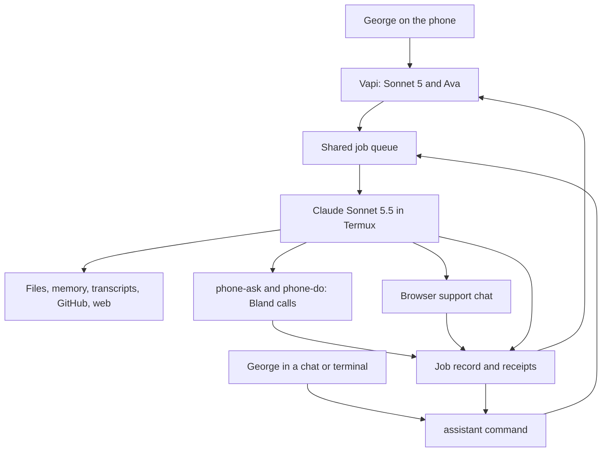

# George’s personal assistant

George gives the assistant a goal by phone or chat. It finds a useful route, carries out the work, and returns the result with proof.

This repository holds the personal Vapi line, the Claude brain bridge, phone errands, support-chat errands, shared job records, instructions, settings, and deployment commands. GitHub is the source of record. The installed phone files come from a committed revision of this repo.

## Purpose

Make useful action as easy as saying what George wants.

Examples include finding a store’s hours, checking stock, making an appointment, recovering a refund, obtaining a credit, removing a fee, arranging extra time to pay, restoring account access, and resolving a service problem.

The assistant chooses among account controls, browser support chat, and phone calls. It follows up, tries another useful route when appropriate, and keeps working within George’s request. It records the actual outcome, the confirmation, and any next step George owns.

The guiding example is a support conversation that obtained a temporary Google Workspace reactivation so a client could receive business email while arranging payment. George described that experience in the October 27, 2026 design discussion. Its role here is the product goal: pursue the result through the available channels.

## Who uses it

George calls **650-252-3543** to talk with his personal assistant. He can also submit a goal from a terminal or an existing chat through the `assistant` command.

When contacting another person by phone or support chat, the system speaks in first person as George, with his authorization. It uses “I,” “my account,” and his supplied identity and facts. Direct questions about automation receive accurate answers.

## How it behaves

- Give the answer first, in short sentences and plain words.
- Keep the reasoning at George’s level.
- Ask a short question when the meaning, goal, or authority is unclear.
- Follow the thread and return to the parent topic after a branch.
- Use recorded facts and label an estimate or inference clearly.
- Give an honest verdict and fix mistakes in the work.
- Share useful ideas with confidence and the main catch; George decides.
- Carry authorized work through to its outcome.
- Announce a lookup before using a tool. Give a useful preliminary answer when one is available, then return the checked answer.
- For an errand, use George’s goal, account facts, and any instructions he gives about spending, plans, timing, or other choices.
- Save the result and its evidence in the shared job record.

The exact voice instructions are in [prompts/voice.txt](prompts/voice.txt). The brain’s work instructions are in [prompts/brain-errand.md](prompts/brain-errand.md).

## One connected system



| Part | Job |
|---|---|
| Vapi | Hears George, runs the fast conversation, speaks through Ava, and calls the three bridge tools |
| Claude in Termux | Reasons about the task and uses files, browser controls, GitHub, phone controls, and the calling commands |
| `phone-ask` | Calls a place and asks up to four questions |
| `phone-do` | Runs a phone errand from a goal card, including menus, hold time, and conversation |
| `support-chat` | Sends a support-chat goal to the same Claude brain, with instructions to use the browser and save proof |
| `assistant` | Submits work, reads jobs, attaches receipts, and reads service status |
| Shared records | Connect the original request, actions, provider call IDs, reports, and proof |
| ngrok | Gives the phone bridge a fixed public address |
| Native Termux keeper | Checks the personal line every minute and restores its processes |

## Voice tools

The Vapi model has three tools:

| Tool | Behavior |
|---|---|
| `memory_lookup(topic)` | Searches the canonical memory index and related note files directly |
| `brain_ask(question)` | Waits up to 20 seconds for a short brain answer; busy or longer work returns through the job path |
| `brain_job(task)` | Queues work, returns a receipt, and lets George keep talking |

The brain can search the saved Claude transcripts on the phone and use its existing phone controls to inspect screenshots. Those results reach the voice model as text.

A job captures its chosen Claude session when queued. The bridge waits for that request’s final `end_turn` answer and `turn_duration` record. This supports tool work that takes longer than a pause in the transcript.

When the brain returns a report, the bridge reads the original Vapi call, checks its personal assistant ID and active state, and adds the report to that call with `triggerResponseEnabled: true`. The voice instructions ask for a brief report at a natural pause.

After a call ends, its job result remains in the local record. A restarted bridge marks pending jobs as `interrupted`, preserving the request for review. Repeated webhook delivery uses the original call and tool-call IDs to find the existing job.

## Shared work and receipts

A job contains:

- ID, original request, source, selected channel, and selected Claude session.
- The goal card and recent call context supplied by Vapi.
- State: `queued`, `running`, `reported`, `incomplete`, `failed`, or `interrupted`.
- Brain report and timestamps.
- Evidence from calls or support chats: source URL, transcript file, provider call ID, answers, confirmation, cost, and next step.
- Delivery state, including acceptance by Vapi or local storage after the call ends.

`reported` means the brain returned its report. The report and receipts describe whether the goal was achieved, partly achieved, refused, or needs input.

Phone commands use `ASSISTANT_JOB_ID` to attach their receipts to the original request. Standalone phone commands create their own call record in the same ledger. Receipts created while the bridge is unavailable are saved in a local outbox; `assistant flush` attaches them later.

Support-chat work uses the logged-in browser, the official support page, George’s account facts, and first-person messages. The brain attaches its transcript or screenshot with `assistant receipt` and returns the outcome through the same job path.

## Current Vapi configuration

The versioned configuration is [config/personal-assistant.json](config/personal-assistant.json). `scripts/sync-vapi.py` applies it to the exact personal assistant ID and reads the saved values back.

| Setting | Value |
|---|---|
| Personal number | `+16502523543` |
| Personal assistant ID | `4346abeb-ee9e-4b7e-a8fa-57f20a32c325` |
| Personal number ID | `4077477e-40b4-4974-8e43-ad5ff10511fc` |
| Talking model | Anthropic `claude-sonnet-5` |
| Brain model | Claude Code `claude-sonnet-5-5` |
| Model temperature | `0.5` |
| Reply token cap | `300` |
| Voice | Azure `en-US-AvaNeural` |
| Transcription | Deepgram `nova-3` |
| Transcriber automatic fallback | Enabled |
| Wait before speaking | `0.2` seconds |
| Smart turn detection | LiveKit |
| LiveKit wait function | `2000 / (1 + exp(-10 * (x - 0.5)))` milliseconds |
| Background speech filtering | Krisp smart denoising enabled |
| Silence before ending the call | `60` seconds |
| Maximum personal call duration | `1800` seconds / 30 minutes |
| Greeting mode | Assistant speaks first |
| Interruption detection | Vapi defaults: voice activity, `0.2` seconds of voice, `1` second backoff |
| Background sound | Vapi phone default, `office` |
| Fourier denoising | Disabled by default |
| Tool server | `https://shivering-entree-humid.ngrok-free.dev/tools` |
| Bridge listener | `127.0.0.1:8790` |

The earlier text-based turn timings remain Vapi defaults: punctuation `0.1` seconds, unfinished text `1.5` seconds, numbers `0.5` seconds. LiveKit controls turn detection for supported English speech.

### Changes made October 27, 2026

- Reduced the speaking wait from the `0.4`-second default to `0.2` seconds.
- Enabled LiveKit smart turn detection.
- Enabled Krisp background speech filtering.
- Raised the silence timeout from `30` to `60` seconds.
- Replaced the long starting prompt with George’s short behavior contract, then added spoken lookup notices and job-result behavior.
- Added automatic job-report delivery into the active call.
- Changed completion detection to use Claude’s final turn record.
- Moved the personal processes to a dedicated native Termux tmux server.
- Added the shared terminal entrypoint, support-chat route, and call/chat receipts.
- Set phone and support-chat interactions with other people to first-person speech as George.
- Preserved Sonnet 5 and Ava for the personal conversation with George.
- Added George Natural as the default voice for outgoing errands, plus local Majestic George previews and digit-by-digit account-number speech.

A recorded personal call before these timing changes averaged `2.0385` seconds per reply across two turns. Its model component averaged `1.1365` seconds; its voice component averaged `0.568` seconds. Source: Vapi call `01a17b79-b49d-7118-a530-0ef27d721dea`.

## Phone errands

`phone-ask` and `phone-do` use the existing Bland account and API key. Both save the provider report, answers, and transcript under `/root/.bland/` and attach a receipt to the shared ledger.

| Setting | `phone-ask` | `phone-do` |
|---|---|---|
| Opening | “Hi, this is George. I have a couple of quick questions.” | “Hi, this is George. I’m calling about my account.” |
| Voice | `george-natural`, the saved Bland clone | `george-natural` by default; card can choose `voice` |
| Question count | Up to four | Goal-driven conversation |
| Call duration cap | Five minutes | Twelve minutes by default; card can set `minutes` |
| Greeting | Wait for the recipient | Wait for the recipient |
| Voicemail action | Hang up | Hang up |
| Provider audio recording | Off | Off |
| Menu and hold behavior | Choose a person/general questions | Choose the useful menu option and wait through hold audio |
| Cost record | Provider-reported call price | Provider-reported call price |

The repo’s original cost estimate was `$0.14` per connected minute. Actual receipts use the provider’s call price and account balance response. Bland’s current plan and rate apply to each account.

Goal cards use `who`, `goal`, `facts`, `limits`, and `fallback`. Phone cards also use `number`; support-chat cards can use `url`. The `limits` field holds George’s instructions for that errand, such as keeping a current subscription plan. The code also applies the call-duration and question-count values shown above.

Examples: [late-fee card](errands/example-late-fee.txt), [store questions](errands/example-store-question.txt), [support chat](errands/example-support-chat.txt).

## George’s voices and number speech

Two voice choices are saved in [config/voices.json](config/voices.json):

| Voice | Use |
|---|---|
| `george-natural` | Bland clone made from George’s accepted training recordings; default for both outgoing calling commands |
| `majestic-george` | George’s trained Piper model, rendered locally by `assistant voice` |

The voice assets were copied from WiM Calls into `/root/.local/share/phone-errands-voices`. The copy contains the Piper model and config, 151 accepted reading takes, and the reference sample used for the Bland clone. [config/voice-assets.json](config/voice-assets.json) records each asset’s size and SHA-256 hash. The private `voice-assets-2026-10-27` GitHub release stores the asset archive.

The number-speaking code derives from WiM Calls’ `sayable` function. It reads account numbers, verification codes, last-four digits, and phone numbers digit by digit, preserving leading zeros and groups. Money, years, and ordinary quantities keep their normal reading. The local Piper renderer expands currency into explicit dollars and cents. Account facts also become a Bland pronunciation guide.

The Bland account accepted George Natural and rejected a second clone with its account voice-limit response. Majestic George remains available through local synthesis. Bland documents a $5 cumulative wallet top-up to expand clone slots.

Both generated previews are saved under `samples/`. [samples/verification.json](samples/verification.json) holds their audio hashes and transcribed words. Their sample text uses example account `0042`, a `$35` charge, and year `2026`. Automated transcription checks the spoken words against that text. Twelve focused checks cover leading zeros, years, money, grouping, call voice selection, and pronunciation-guide construction.

```sh
assistant voice --voice majestic-george --text "My account number is 0042." --out /tmp/majestic.wav
assistant voice --voice george-natural --text "My account number is 0042." --out /tmp/natural.wav
```

Restore local voice assets inside Debian after downloading the private release archive:

```sh
python3 scripts/restore-voice-assets.py george-voice-assets-20261027.tar.gz
python3 -m venv /root/.local/share/phone-errands-voices/venv
/root/.local/share/phone-errands-voices/venv/bin/pip install -r config/voice-requirements.txt
```

## Commands

From native Termux, the installed command wrappers enter Debian. From a Claude session in Debian, the same names run directly.

```sh
assistant status
assistant jobs
assistant jobs JOB_ID
assistant ask "Read the latest Heirloom release and report what changed"
assistant submit errands/example-support-chat.txt --preview
support-chat errands/example-support-chat.txt --dry
assistant submit MY_REAL_CARD --channel auto
support-chat MY_REAL_SUPPORT_CHAT_CARD
ASSISTANT_JOB_ID=JOB_ID phone-do MY_REAL_PHONE_CARD
assistant receipt JOB_ID --outcome achieved --summary "Credit posted" --confirmation "REFERENCE"
assistant flush
```

The examples show the command shape. George supplies the actual task, recipient, account facts, and authority for an external call or message.

Session commands inside Debian:

```sh
voice-list
voice-use SESSION_NAME
voice-session NEW_SESSION_NAME
bash /root/.vapi/bridge/phone.sh status
bash /root/.vapi/bridge/phone.sh attach
bash /root/.vapi/bridge/phone.sh restart
```

`voice-use` selects a registered managed session. Full conversation sharing between the fast voice and an arbitrary existing chat is a next build. The current shared layer is the job record, recent call context, and the chosen brain session.

## Code and deployment

Runtime dependencies: native Termux, Debian PRoot, Python 3, Node.js 20, Bash, curl, tmux, ngrok, and the installed Claude Code CLI. The bridge uses Node’s built-in modules. The command tools use Python’s standard library.

| Path | Contents |
|---|---|
| `voice/` | HTTP bridge, queue, Claude transcript reader, job ledger, and process control |
| `phone-ask`, `phone-do` | Bland calling commands |
| `assistant`, `support-chat`, `assistant_records.py`, `voice_catalog.py`, `speech_text.py` | Shared work entrypoints and receipts |
| `prompts/` | Voice and brain behavior |
| `config/` | Personal Vapi settings and tool definitions |
| `bin/` | Managed-session commands and native keeper |
| `scripts/install.py` | Install a committed revision, back up replaced files, restart the personal bridge, and save a deployment receipt |
| `scripts/sync-vapi.py` | Apply/read back the exact personal Vapi configuration |
| `scripts/check-idle.py` | Read the personal line’s active calls before a restart |
| `scripts/verify-runtime.py` | Require local and public endpoints to report the installed revision |

Install from native Termux:

```sh
python scripts/install.py --apply --sync-vapi
```

Read back settings inside Debian:

```sh
python3 /root/.local/share/phone-errands/scripts/sync-vapi.py
```

The deployment script installs code at `/root/.local/share/phone-errands`, bridge code at `/root/.vapi/bridge`, and command links under `/usr/local/bin`. Native wrappers live under `~/.local/bin`.

The native tmux socket is `/data/data/com.termux/files/usr/var/run/tmux-10435/vapi-line`. Its personal sessions are `brain`, `vsrv`, `vtun`, and `control`. The control session runs the one-minute keeper. Each service command enters Debian explicitly. Process control tracks the personal bridge and stops its existing Node process before replacing it, including a child left behind by a PRoot restart.

Local data locations:

| Location | Data |
|---|---|
| `/root/.vapi/bridge/jobs/` | Shared job records and evidence |
| `/root/.bland/calls/` | Question-call reports and transcripts |
| `/root/.bland/errands/` | Phone-errand cards, reports, and transcripts |
| `/root/.local/state/phone-errands/receipt-outbox/` | Receipts waiting to attach |
| `/root/.claude/projects/-root/` | Claude chat transcripts |
| `/root/.claude/projects/-root/memory/` | Canonical memory notes, read-only to this project |
| `~/.local/state/phone-errands/deployments/` in Termux | Replaced-file backups and installation receipts |

Credentials stay in local files: Vapi in `/root/.gmail/aicalls.env`, Bland in `/root/.bland/key`, bridge authentication in `/root/.vapi/bridge/line.key`, and ngrok authentication in its existing config. Model billing uses the existing Anthropic credential attached to the personal Vapi assistant.

The saved `REVISION` and authenticated `/status` response identify the running code. Deployment verification uses source syntax checks, the local/public status responses, process ownership, installed-file hashes, and Vapi configuration readback.

## Next builds

1. Observe one personal voice call while a useful job runs and its report returns.
2. Share a continuous conversation history between a chosen ongoing chat and the fast voice, with clear speaker labels and current task state.
3. Let an outbound business call bring a question back to George’s private call and relay his answer while the business waits.
4. Keep track of goals George has asked the assistant to follow, and bring back changes and results.
5. Measure outcomes: money recovered, credits obtained, fees removed, access restored, useful answers, and time saved.

The first integration exercise is one real inquiry, with its call/chat transcript and confirmation attached to the original job record.

## References

- [Bland voice cloning](https://docs.bland.ai/api-v1/post/clone)
- [Bland voice-slot limits](https://docs.bland.ai/speech/limits)

- [Vapi conversation timing](https://docs.vapi.ai/customization/voice-pipeline-configuration)
- [Vapi live call control](https://docs.vapi.ai/calls/call-features)
- [Vapi background speech filtering](https://docs.vapi.ai/documentation/assistants/conversation-behavior/background-speech-denoising)
- [Bland API tools during calls](https://docs.bland.ai/tutorials/tools/custom-api)
- [Bland pricing](https://www.bland.ai/pricing)
